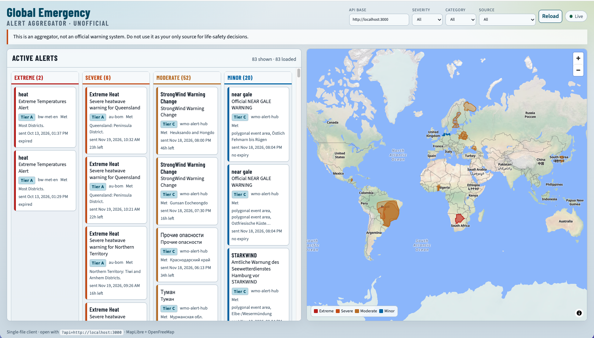

# Global Emergency Alert Monitor

Ingests official CAP / emergency feeds, normalizes them, stores them in PostGIS, and shows them on a live board + map.

**This is an aggregator, not an official warning system.** Do not rely on it alone for life-safety decisions.



## Layout

| Path | Role |
|------|------|
| `ge-api/` | NestJS API, worker, Postgres/Redis via Docker Compose |
| `ge-html/` | Single-file board + MapLibre client |
| `docs/` | Design spec and source list |

## Quick start

```bash
# Infra (from ge-api)
cd ge-api
cp .env.example .env
docker compose up -d
npm install

# API (HTTP + SSE)
npm run start:dev

# Worker (poll feeds → DB → Redis pub/sub)
npm run start:worker:dev
```

Open the UI: `ge-html/ge-aggregator.html?api=http://localhost:3000`

Useful API routes: `GET /alerts`, `GET /alerts/:id`, `GET /stream`, `POST /alerts/ingest`.

## Stack

NestJS · BullMQ · Redis · PostgreSQL + PostGIS · CAP Atom adapters · MapLibre

Sources live in `ge-api/src/config/sources.yaml` (seeded from `docs/sources`).
